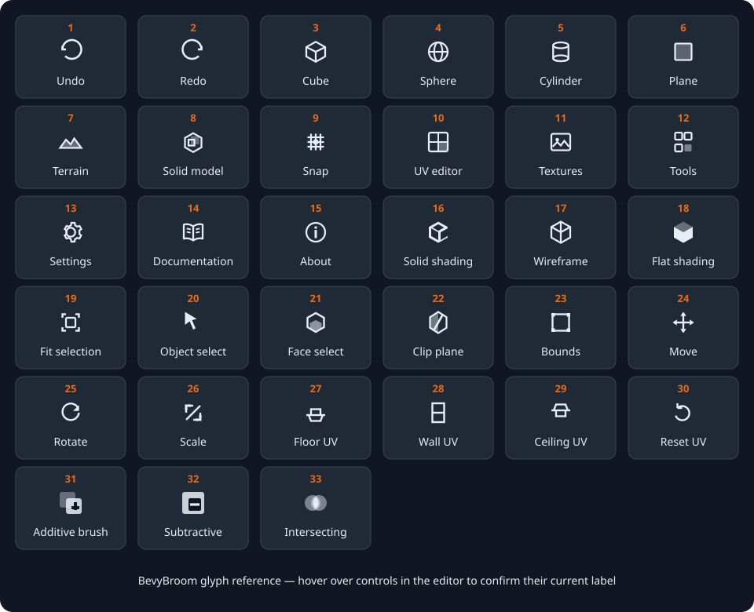
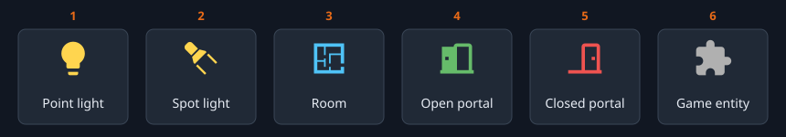

# Glyph Reference

BevyBroom uses compact glyphs so the viewports have more room for the world you are building. This reference shows the current glyphs and explains what happens when you select each one.

The orange number above each visual example matches the tables below. In the editor, hover over a glyph to see its current name. An orange-highlighted button represents an active mode or enabled option; a dim button is unavailable in the current context.

## Main toolbar glyphs

| No. | Glyph | What it does                                                                                                                                              |
| --- | ----- | --------------------------------------------------------------------------------------------------------------------------------------------------------- |
| 1   | Undo  | Reverses the most recent undoable edit. The bottom status bar shows how many undo steps are available.                                                    |
| 2   | Redo  | Reapplies the most recently undone edit. It is unavailable when there is no redo history.                                                                 |
| 9   | Snap  | Turns grid snapping on or off. When highlighted, compatible transforms use the grid size shown in the **Grid** dropdown next to it and in the status bar. |

The toolbar also holds the tool buttons described under
[Tool glyphs](#tool-glyphs), the **Grid** size dropdown, the **Global** and
**Local** gizmo axes, the **Pos Lock** and **Stretch Lock** toggles, and the
**MCP** server button.

### Glyphs that moved into the menus

The numbered plate still shows glyphs 10 to 15, but these actions no longer
have toolbar buttons:

| No. | Former glyph    | Where the action lives now                                                                                                      |
| --- | --------------- | ------------------------------------------------------------------------------------------------------------------------------- |
| 10  | UV Editor       | The face attributes at the top of the inspector's **Face** tab (`Ctrl+3`). See [Face attribute glyphs](#face-attribute-glyphs). |
| 11  | Texture Browser | The material browser at the bottom of the inspector's **Face** tab (`Ctrl+3`).                                                  |
| 12  | Tools           | The tool buttons in the toolbar and the tool options in the view bar above the viewports. See [Tool glyphs](#tool-glyphs).      |
| 13  | Settings        | **File > Preferences…** opens the Settings dialog for view, mouse, keyboard, game profile, and update preferences.              |
| 14  | Documentation   | **Help > Documentation** opens the web-hosted user guide in a separate browser tab.                                             |
| 15  | About           | **Help > About BevyBroom…** opens application information, version, license, and contributor details.                           |

Cube, sphere, cylinder, plane, terrain, and solid-model creation live in the
categorized **Add** menu instead of occupying separate toolbar glyphs.
Choose **Geometry**, **Terrain**, or **Brushes**, then select the object type;
the editor creates and selects it. **Tools > Solid Model…** opens the Solid
Model panel rather than creating one.

## Viewport header glyphs

Each viewport has its own shading and framing controls. A change made here applies to that viewport, allowing one view to remain solid while another displays wireframe geometry.

| No. | Glyph         | What it does                                                                                                        |
| --- | ------------- | ------------------------------------------------------------------------------------------------------------------- |
| 16  | Solid shading | Displays normally shaded surfaces. This is the clearest general-purpose view for judging form and materials.        |
| 17  | Wireframe     | Displays mesh edges without filled surfaces, making hidden structure and overlapping shapes easier to inspect.      |
| 18  | Flat shading  | Displays distinct polygon faces without smooth interpolation. Use it to inspect face boundaries and faceting.       |
| 19  | Fit selection | Frames the current selection in that viewport. It is the button equivalent of pressing `F` while working in a view. |

Wireframe Overlay is available through the `4` shortcut but does not have a dedicated header glyph. It shows shaded surfaces and their wire edges together.

## Tool glyphs

Glyphs 20 to 22 are tool buttons in the toolbar; they choose what kind of editing the pointer performs. The tool options on the left of the view bar above the viewports change to match the selected tool. With Object Select active they show glyphs 23 to 26.

| No. | Glyph         | What it does                                                                                                                                    |
| --- | ------------- | ----------------------------------------------------------------------------------------------------------------------------------------------- |
| 20  | Object Select | Makes clicks and drag-selection target complete objects. Use this before moving, rotating, scaling, grouping, duplicating, or deleting objects. |
| 21  | Face Select   | Makes selection target surface regions. Use it before per-face texturing, UV editing, or extrusion.                                             |
| 22  | Clip Plane    | Starts the three-point clipping workflow for selected geometry. Place three points, inspect the preview, then Flip, Clip, or Split.             |
| 23  | Bounds        | Shows a resizable bounding box around the object selection. Drag a face or handle to change dimensions; default shortcut `T`.                   |
| 24  | Move          | Shows translation handles for moving along axes or planes; default shortcut `W`.                                                                |
| 25  | Rotate        | Shows rotation handles for turning the selection around an axis; default shortcut `E`.                                                          |
| 26  | Scale         | Shows scale handles for proportional or per-axis resizing; default shortcut `R`.                                                                |

The toolbar also has a **Grid** tool button after Clip Plane; it is not part of the numbered plate. The Face Select options contain text actions for **Face Inspector**, which shows the inspector's Face tab, and **Extrude**, while Clip Plane uses text buttons for **Flip**, **Clip**, and **Split**. Their visible words are the glyphs' labels, so they are not repeated in the numbered visual plate.

## Face attribute glyphs

These buttons sit in the face attributes at the top of the inspector's **Face** tab. They establish a sensible surface orientation before you refine scale, offset, or rotation, and they affect the currently selected face regions. Their tooltips read **Align to Floor**, **Align to Wall**, **Align to Ceiling**, and **Reset UVs**.

| No. | Glyph   | What it does                                                                                               |
| --- | ------- | ---------------------------------------------------------------------------------------------------------- |
| 27  | Floor   | Aligns mapping for an upward-facing horizontal surface. Use it for floors, platforms, and tops of objects. |
| 28  | Wall    | Aligns mapping for a vertical surface. Use it for walls and upright sides.                                 |
| 29  | Ceiling | Aligns mapping for a downward-facing horizontal surface. Use it for ceilings and undersides.               |
| 30  | Reset   | Restores the selected surfaces' default UV mapping while retaining their assigned texture.                 |

## Solid-brush operation glyphs

These glyphs appear in the Properties panel when an editable brush inside a solid model is selected. The highlighted glyph is the operation currently assigned to the selected brush; order still affects the final result.

| No. | Glyph        | What it does                                                                                                    |
| --- | ------------ | --------------------------------------------------------------------------------------------------------------- |
| 31  | Additive     | Adds the brush's volume to the solid-model result. Use it for walls, floors, platforms, and other matter.       |
| 32  | Subtractive  | Removes the brush's volume from the result. Use it to carve doors, windows, rooms, shafts, and other openings.  |
| 33  | Intersecting | Restricts the current result according to the brush's overlapping volume at that point in the evaluation order. |

## Hierarchy glyphs

The hierarchy uses colored characters and emoji rather than the outlined toolbar icon set. Their appearance can vary slightly with the operating system's font, but their meaning is consistent.

### Expand, visibility, and lock states

| Visual example  | Meaning and action                                                                                  |
| --------------- | --------------------------------------------------------------------------------------------------- |
| `▶`             | The item has hidden children. Select the triangle to expand it.                                     |
| `▼`             | The item's children are visible. Select the triangle to collapse them.                              |
| Open eye SVG    | The object is visible. Select the eye to hide it temporarily.                                       |
| Eye + red slash | The object is hidden. Select it to restore visibility. The red diagonal is an extra hide cue.       |
| `🔓`            | The object is unlocked and can be edited. Select it to protect the object.                          |
| `🔒`            | The object is locked against editing, deletion, and transformation. Select it to unlock the object. |

### Object-type glyphs

Object-type glyphs identify what an item represents; selecting one selects the corresponding hierarchy item rather than performing an immediate action.

| Visual example | Color in the editor | Meaning                                                            |
| -------------- | ------------------- | ------------------------------------------------------------------ |
| `📁`           | Orange              | Group containing child objects.                                    |
| `▣`            | Orange              | Solid-model root containing ordered brushes and a compiled result. |
| `▪`            | Green               | Editable solid brush volume.                                       |
| `▦`            | Amber               | Compiled visible result of a solid model.                          |
| `◼`            | Blue                | Cube or box mesh.                                                  |
| `●`            | Green               | Sphere mesh.                                                       |
| `▭`            | Purple              | Plane mesh.                                                        |
| `⬡`            | Teal                | Cylinder mesh.                                                     |
| `◇`            | Gray                | Mesh whose source shape has no more specific glyph.                |
| `☀`            | Orange              | Directional light.                                                 |
| `✧`            | Yellow              | Other light type.                                                  |
| `📷`           | Red                 | Camera object.                                                     |
| `○`            | Gray                | Other or unrecognized object type.                                 |

## Entity icons

Lights, rooms, portals and game entities share one icon set, taken from
Material Design Icons. The same icon marks the object in the **Add** menu, its
hierarchy row, the header of its Properties section and the 3D and 2D
viewports.

| No. | Icon         | Color                         | Meaning                                                                |
| --- | ------------ | ----------------------------- | ---------------------------------------------------------------------- |
| 1   | Light bulb   | The light's color             | Point light.                                                           |
| 2   | Spotlight    | The light's color             | Spot light. Its cone shows the inner and outer angles.                 |
| 3   | Floor plan   | Cyan                          | Room (a DynLight cell). The box outline shows its size.                |
| 4   | Open door    | Green                         | Open portal between two rooms.                                         |
| 5   | Closed door  | Red                           | Closed portal; light and visibility do not pass through it.            |
| 6   | Puzzle piece | The marker color of its class | Game entity. The Add menu shows each component class in its own color. |

In the viewports lights, rooms and game entities are drawn as a small
translucent box in the icon's color, with the icon inside. The icon always faces
the camera. Click the box to select the object; the icon itself is never
picked. A disabled light draws its box and icon faded. A selected light also
shows its range, cone and fog outline and orange balls for its radius and, on spot lights, its cone angle. The boxes, icons and balls draw in every view, including the wireframe top, front and side views.

## Common non-icon controls

Some compact controls are typographic symbols rather than drawn glyphs:

| Visual example                    | What it does                                                                                     |
| --------------------------------- | ------------------------------------------------------------------------------------------------ |
| A menu name in the menu bar       | Opens the menu. If another menu is already open, moving across menu names switches between them. |
| **Add**                           | Opens categorized menus such as Geometry, Terrain, and Brushes for creating scene objects.       |
| **Grid** `▾` beside Snap          | Shows the current grid size and opens the list of preset grid sizes.                             |
| `×` in a floating-panel title bar | Closes that panel without deleting scene content or undoing edits already applied.               |
| `+ Box Brush`                     | Adds a new box brush to the active solid model.                                                  |

## If a glyph is unavailable

A dim or disabled glyph usually means that the editor needs a different selection or mode. Hover over it for its label, then check the status bar and confirm:

1. The appropriate object or face region is selected.
2. The required Object Select, Face Select, or Clip Plane tool is active.
3. The selected object is not locked.
4. A modal interaction is not waiting to be committed or canceled.

For a broader explanation of where these controls appear, see [Understanding the interface](understanding_the_interface.md).
